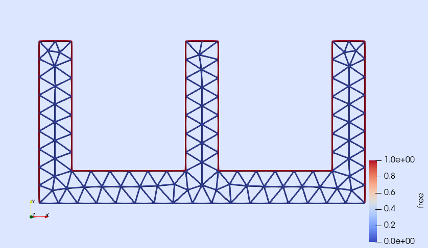
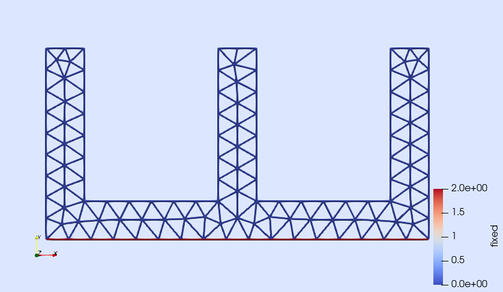
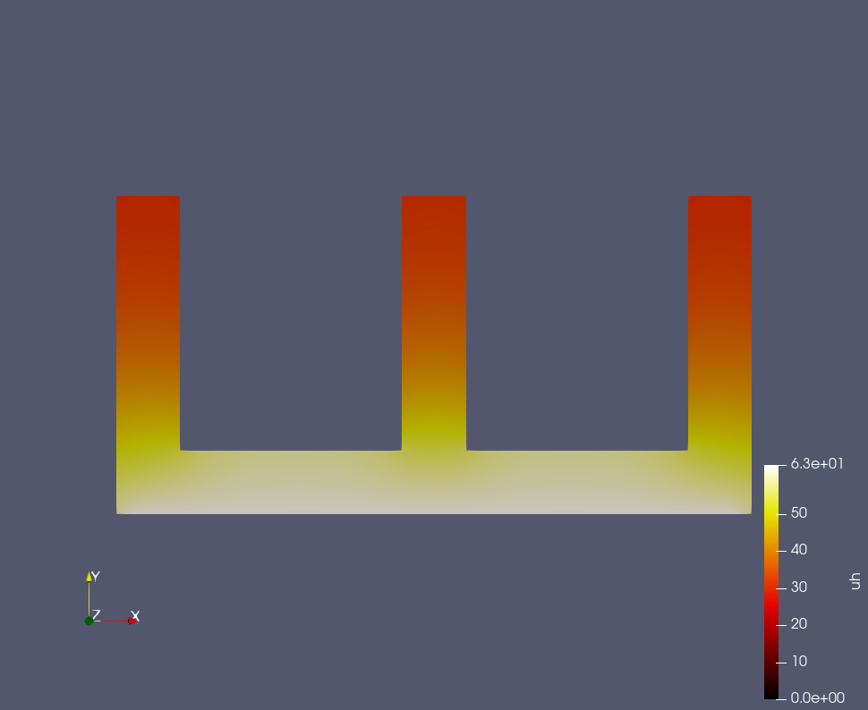

```{julia}
#| echo: false
tcf(filename::String) = (@__DIR__) * "\\" * filename;
import Pkg; Pkg.activate((@__DIR__)*"\\..")
```

# Задача теплопроводности

Во многих инженерных задачах важным аспектом является знание распределения температуры в теле. Всем известно, что при нагреве тела расширяются, и это приводит к возникновению тепловых напряжений. Если мы знаем количество подводимого и выделяемого телом тепла, то можно определить распределение температуры в его объеме, а следовательно — распределение напряжений, знание которых необходимо при проектировании вращающихся механизмов. Например, реактивных двигателей, паровых генераторов и даже червячных редукторов.

## Уравнения переноса тепла

Перенос тепла или теплопередача является сложным процессом, который можно разделить на три элементарных способа переноса теплоты: теплопроводность, конвекция и тепловое излучение. Теплопроводностью называется процесс переноса теплоты при непосредственном контакте более нагретых элементов тела (или среды) с менее нагретыми, осуществляемый посредством хаотического движения и взаимодействия микрочастиц (молекул, атомов, электронов, ионов). Явление конвекции наблюдается в движущихся жидкостях или газах. Перенос теплоты при этом происходит за счет перемещения вещества в пространстве. Тепловым излучением называется явление переноса теплоты в виде электромагнитных волн с двойным взаимным превращением — тепловой энергии в лучистую и обратно. В большинстве случаев виды теплообмена не существуют обособленно. Например, обмен теплотой между твердой поверхностью и жидкостью (или газом) происходит путем теплопроводности и конвекции одновременно и называется конвективным теплообменом или теплоотдачей.

Процесс теплопроводности неразрывно связан с распределением температуры внутри тела. Поэтому при его изучении прежде всего необходимо установить некоторые понятия:

**Температурное поле** — это совокупность значений температуры для всех точек пространства в данный момент времени.

**Температурный градиент** — вектор, направленный по нормали к изотермической поверхности в сторону возрастания температуры, $\left[\frac{^{\	ext{o}}\text{C}}{\text{м}}\right]$.

**Тепловой поток**. Теплота самопроизвольно переносится только в сторону убывания температуры. Количество теплоты, переносимое через какую-либо изотермическую поверхность в единицу времени, называется тепловым потоком $Q$. Тепловой поток, отнесенный к единице площади изотермической поверхности, называется плотностью теплового потока $q$. Плотность теплового потока есть вектор, направление которого совпадает с направлением распространения теплоты в данной точке и противоположно направлению вектора температурного градиента.

Изучая процесс теплопроводности в твердых телах, Фурье экспериментально установил, что количество переданной теплоты пропорционально падению температуры, времени и площади сечения, перпендикулярного направлению распространения теплоты. Если количество переданной теплоты отнести к единице площади сечения и единице времени, то установленную зависимость можно записать закон Фурье:

$$
\mathbf{q} = -\lambda \nabla T, \tag{1}
$$

где $\mathbf{q}$ — плотность теплового потока, $\left[\frac{\text{Вт}}{\text{м}^2}\right]$, $\lambda$ — коэффициент теплопроводности, $\left[\frac{\text{Вт}}{\text{м} \cdot \text{К}}\right]$. Является физическим параметром, характеризует способность данного вещества проводить тепло и численно равен количеству теплоты, переданному в единицу времени через единицу поверхности при градиенте температуры, равном единице.

Еще одним важным уравнением является дифференциальное уравнение энергии:

$$
\rho \cdot C_m \cdot \frac{\partial T}{\partial t} = q_v - \nabla \cdot \mathbf{q}, \tag{2}
$$

где $\rho$ — плотность вещества, $\left[\frac{\text{кг}}{\text{м}^3}\right]$, $C_m$ — весовая теплоемкость вещества, $\left[\frac{\text{Дж}}{\text{кг}\cdot \text{К}}\right]$, $q_v$ — мощность внутреннего источника теплоты, $\left[\frac{\text{Вт}}{\text{м}^3}\right]$. Данное уравнение говорит о том, что температура изменяется из-за выноса тепла или из-за внутреннего источника теплоты.

Если подставить уравнение Фурье в уравнение энергии, то получим уравнение Фурье-Кирхгофа:

$$
\rho \cdot C_m \cdot \frac{\partial T}{\partial t} = q_v + \nabla \cdot (\lambda \nabla T). \tag{3}
$$

Для решения задач также необходимы условия однозначности: геометрические условия, временные (стационарный или нестационарный режим), физические условия (функциональное или числовое задание всех характеристик, входящих в задачу), а также граничные условия.

Виды граничных условий:

1) **I-го рода** или условие Дирихле: задание числового значения распределения температуры на поверхности тела для каждого момента времени.

$$
T(\mathbf{x}) = T_{D}(\mathbf{x}), \quad \text{для } \mathbf{x} \in \partial \Omega_D. \tag{4}
$$

где $\partial \Omega_D$ — граница области, на которой заданы условия Дирихле, а $T_D$ — температура на данной границе.

2) **II-го рода** или условие Неймана: задание первой производной на границе (задается величина теплового потока для каждой точки поверхности тела)

$$
-\lambda (\nabla T) \cdot \mathbf{n} = -\lambda \frac{\partial T}{\partial n} = q_s. \tag{5}
$$

3) **III-го рода**: задается температура окружающей среды и закон теплообмена между поверхностью тела и окружающей средой в процессе охлаждения и нагревания. Для его описания используется закон Ньютона–Рихмана (правая часть уравнения): плотность теплового потока пропорциональна разности температур поверхности тела.

$$
-\lambda \frac{\partial T}{\partial n} = \alpha (T_c - T_a), \tag{6}
$$

где $\alpha$ — коэффициент теплоотдачи, характеризующий интенсивность теплообмена между поверхностью тела и окружающей средой, $\left[\frac{\text{Вт}}{\text{м}^2 \cdot \text{К}}\right]$, $T_c$ и $T_a$ — температура стенки и окружающей среды соответственно, [K].

Коэффициент теплоотдачи при естественной конвекции для газа 5–15 $\left[\frac{\text{Вт}}{\text{м}^2 \cdot \text{К}}\right]$, для жидкости 100–1000 $\left[\frac{\text{Вт}}{\text{м}^2 \cdot \text{К}}\right]$. При вынужденной конвекции 10–500 $\left[\frac{\text{Вт}}{\text{м}^2 \cdot \text{К}}\right]$ для газа и 500–10000 $\left[\frac{\text{Вт}}{\text{м}^2 \cdot \text{К}}\right]$ для воды.

## Слабая постановка

Мультифизическое моделирование основано на дифференциальных уравнениях в частных производных (ДУЧП), которые выводятся из различных законов сохранения (массы, энергии, импульса). Данные уравнения могут быть также сформулированы в интегральном виде для произвольных областей. Члены уравнения в виде объемных интегралов описывают сохранение или добавление вещества источником, а интегральные уравнения по поверхности описывают взаимодействие с внешней средой.

Если функции, которые используются для вычисления, гладкие, то по теореме Остроградского-Гаусса можно преобразовать поверхностные интегралы в объемные интегралы. Поскольку расчетная область является произвольной, результирующее уравнение должно быть действительным или определенным в каждой точке по отдельности, что в итоге сводит интегральное уравнение в ДУЧП.

Однако функции не всегда достаточно гладкие, например свойства материала. Поэтому теорему Остроградского-Гаусса нельзя применять повсеместно. Следовательно, стандартная процедура вывода ДУЧП является слишком строгой и не допускает многие физически возможные решения.

Для решения подобной проблемы используется постановка в слабой форме. Слабая форма возвращает интегральную формулировку уравнения и изменяет процедуру вывода ДУЧП, делая ее менее строгой.

Рассмотрим процедуру получения слабой формы уравнения:

$$
\nabla \cdot (-\lambda \nabla u) = q_v, \tag{7}
$$

где $\lambda$ и $q_v$ — являются коэффициентом теплопроводности и потоком теплоты соответственно.

Если неизвестная функция $u$ является решением исходного ДУЧП, она также является решением следующего интегрального уравнения:

$$
\int_{\Omega} \nabla \cdot (-\lambda \nabla u) \, v = \int_{\Omega} q_v \, v. \tag{8}
$$

Это результат умножения ДУЧП на произвольную функцию $v$ с последующим применением интеграла по $\Omega$ с обеих сторон уравнения. В свою очередь функция $u$, которая разрешает интегральное уравнение для достаточного числа различных функций $v$, может быть решением исходного ДУЧП. Таким образом, функции $v$ называются пробными (или тестовыми). Данные функции играют важную роль в методе конечных элементов.

Преобразование ДУЧП в данное интегральное уравнение уже является слабой формой, но для учета различных граничных условий необходимо разбиение пространства интегрирования на подобласти. Для этой цели применяется интегрирование по частям для производных второго порядка, что позволяет учитывать граничные условия. Перепишем левую часть предыдущего интегрального уравнения следующим образом:

$$
\int_{\Omega} \nabla \cdot (-\lambda \nabla u) \, v = \int_{\Omega} \lambda \nabla u \cdot \nabla v + \int_{\partial \Omega} -\lambda \nabla u \cdot \mathbf{n} \, v. \tag{9}
$$

где $\partial \Omega$ является границей области $\Omega$ и $\mathbf{n}$ — вектор нормали, ориентированный в сторону от области. Используя эту формулу, итоговая слабая форма уравнения записывается как:

$$
\int_{\Omega} \lambda \nabla u \cdot \nabla v - \int_{\Omega} q_v \, v + \int_{\partial \Omega} -\lambda \nabla u \cdot \mathbf{n} \, v = 0. \tag{10}
$$

Интеграл по границе отвечает за взаимодействие с окружающим область пространством (описывает тепловой поток через границу. Если теплового потока нет, то граница теплоизолирована).

Функция $u$ называется слабым решением ДУЧП, если она является решением слабого уравнения для множества различных пробных функций $v$. Точнее, мы рассматриваем не просто одну пробную функцию. $v$ представляет целый класс пробных функций, каждая из которых соответствует уравнению. Рассмотреть все возможные пробные функции не представляется возможным, так как это приводит к бесконечному множеству уравнений, поэтому необходимо подобрать конечное число пробных функций при помощи конечных элементов.

Для вычислительной области строится так называемая сетка, которая делит геометрическую область исследования на набор меньших объемов — конечных элементов. Затем пробные функции могут быть определены с использованием многочленов (полиномов) для каждого элемента таким образом, чтобы они отличались от нуля только для небольшой группы соседних элементов и были равны нулю вне группы. Наиболее распространенный тип многочленов, построенных таким образом, известен как функции формы Лагранжа.

Далее рассмотрим вывод слабой формы для граничного условия второго рода:

$$
-\lambda \nabla T(\mathbf{x}) \cdot \mathbf{n}(\mathbf{x}) = q, \quad \text{для } \mathbf{x} \in \partial \Omega_N. \tag{11}
$$

$$
\int_{\partial \Omega} -\lambda \nabla u \cdot \mathbf{n} \, v = \int_{\partial \Omega} q \, v. \tag{12}
$$

Третьего рода:

$$
-\lambda \nabla T(\mathbf{x}) \cdot \mathbf{n}(\mathbf{x}) = \alpha (T_c - T_a), \quad \text{для } \mathbf{x} \in \partial \Omega_N. \tag{13}
$$

$$
\int_{\partial \Omega} -\lambda \nabla u \cdot \mathbf{n} \, v = \int_{\partial \Omega} \alpha \cdot u \, v - \int_{\partial \Omega} \alpha \cdot T_a \cdot v. \tag{14}
$$

## Пример решения задачи

Рассмотрим стационарный случай, тогда уравнение Фурье-Кирхгофа для теплопроводности в сплошной среде имеет вид:

$$
-\nabla \cdot \boldsymbol{\lambda} \nabla T(\mathbf{x}) + q_v(\mathbf{x}) = 0, \quad \text{для } \mathbf{x} \in \Omega. \tag{15}
$$

где $\mathbf{x} = \{x \; y \; z\}^T$ — вектор пространственных координат, $\Omega$ — область решения задачи, определяемая геометрией рассматриваемого тела, $\boldsymbol{\lambda} = \{\lambda_{xx} \; \lambda_{yy} \; \lambda_{zz}\}^T$ — вектор коэффициентов теплопроводности в направлениях $x$, $y$ и $z$, размерности $\text{кВт}/(\text{м} \cdot \text{К})$, и $q_v$ — мощность внутреннего источника теплоты, размерности $\left[\frac{\text{Вт}}{\text{м}^3}\right]$. В уравнении неизвестным является скалярное поле температур $T(\mathbf{x})$, и именно его необходимо определить при решении задачи.

Для решения задачи необходимы граничные условия. Зададим температуру на нижней поверхности тела — граничное условие I-го рода, или условие Дирихле:

$$
T(\mathbf{x}) = T_{D}(\mathbf{x}), \quad \text{для } \mathbf{x} \in \partial \Omega_D. \tag{16}
$$

где $\partial \Omega_D$ — граница области, на которой заданы условия Дирихле, а $T_D$ — температура на данной границе.

На остальных границах зададим граничное условие III-го рода — конвективный теплообмен с окружающей средой.

$$
\lambda \nabla T(\mathbf{x}) \cdot \mathbf{n}(\mathbf{x}) = \alpha (T_c - T_a), \quad \text{для } \mathbf{x} \in \partial \Omega_N. \tag{17}
$$

где $\partial \Omega_N$ — граница области, на которой заданы условия Неймана, $\mathbf{n}(\mathbf{x})$ — вектор нормали к границе, а $Q(\mathbf{x})$ — тепловой поток на данной границе.

## Формулировка задачи

В данной задаче необходимо рассчитать температурное поле радиатора охлаждения, подключенного к однофазному диодному мосту в общем корпусе. Размер нижней грани радиатора — 10 единиц, высота — 5 единиц, толщина ребра — 1 единица, количество ребер — 3, материал — алюминий ($\lambda = 210 \; \frac{\text{Вт}}{\text{м} \cdot \text{К}}$), вынужденный теплообмен ($\alpha = 20 \; \frac{\text{Вт}}{\text{м}^2 \cdot \text{К}}$). Задача будет рассмотрена в двухмерной постановке.

## Создание геометрии

Изначально родным для Gridap форматом геометрии является формат `.json`, имеющий определенную структуру. Однако более удобно использовать существующую библиотеку Gmsh для построения геометрии, имеющую большое количество возможностей и являющуюся, по мнению авторов, наиболее мощной open-source библиотекой для построения расчетных неструктурированных сеток.

```{julia}
using Gmsh

# инициализация gmsh
gmsh.initialize() # инициализация ядра gmsh

gmsh.option.setNumber("General.Terminal", 0); # отключение вывода в терминал логов

ms_max = 1;
ms_min = 0.1;
MSFC = 3;
# порядок элементов
EL_ORDER = 1

#установка параметров gmsh

gmsh.option.setNumber("Mesh.MaxNumThreads3D", 1);
gmsh.option.setNumber("Mesh.ElementOrder", EL_ORDER);

# создание модели
gmsh.model.add("t4")

# параметры радиатора
height = 5;
width = 10;
rib_th = 1;
rib_num = 3;

# зазор между ребрами
sp = (width - rib_num * rib_th) / (rib_num - 1);

# размер элементов
Lc1 = 0.3;

# создание "фабрики"
factory = gmsh.model.geo;

# создание угловых узлов
factory.addPoint(-width/2, 0,       0, Lc1, 1);
factory.addPoint( width/2, 0,       0, Lc1, 2);
factory.addPoint( width/2, height,  0, Lc1, 3);
factory.addPoint(-width/2, height,  0, Lc1, 4);

# создание угловых узлов ребер
x1 = -width/2 + rib_th;
x2 = -width/2 + rib_th + sp;

factory.addPoint(x1, height, 0, Lc1, 5);
factory.addPoint(x1, rib_th, 0, Lc1, 6);
factory.addPoint(x2, rib_th, 0, Lc1, 7);
factory.addPoint(x2, height, 0, Lc1, 8);

x1 = -width/2 + 2*rib_th + sp;
x2 = -width/2 + 2*rib_th + 2*sp;

factory.addPoint(x1, height, 0, Lc1, 9);
factory.addPoint(x1, rib_th, 0, Lc1, 10);
factory.addPoint(x2, rib_th, 0, Lc1, 11);
factory.addPoint(x2, height, 0, Lc1, 12);

# обводка контура
factory.addLine(1, 2, 1);
factory.addLine(2, 3, 2);
factory.addLine(1, 4, 3);

for i in 4:11
    factory.addLine(i, i+1, i);
end
factory.addLine(12, 3, 12);

# объявление границ, по которым будут накладываться граничные условия
factory.addPhysicalGroup(1, [2, 3, 4, 5, 6, 7, 8, 9, 10, 11, 12], -1, "free");
factory.addPhysicalGroup(1, [1], -1, "fixed");

factory.synchronize();

# объединение контура
factory.addCurveLoop([-2, -1, 3, 4, 5, 6, 7, 8, 9, 10, 11, 12], 17);

# создание поверхности внутри контура
factory.addPlaneSurface([17], 18)

factory.synchronize()

# создание группы с поверхностью -> необходимо для генерации геометрии
factory.addPhysicalGroup(2, [18], -1, "coller");

factory.synchronize()

# генерация сетки
gmsh.model.mesh.generate(2)

# результат пишем в файл geo.msh в папке урока
name = "geo.msh" |> tcf;
print(name)
gmsh.write(name)

# заканчиваем работу gmsh
gmsh.finalize()
```

Полученная геометрия имеет две поверхности — нижняя грань, по которой предполагается контакт с поверхностью, помечена меткой `"fixed"`, остальная часть границы помечена меткой `"free"`.

## Загрузка геометрии в Gridap

Для загрузки `.msh` геометрии используется библиотека GridapGmsh, которая конвертирует в формат Gridap.

```{julia}
using Gridap
using GridapGmsh

model = GmshDiscreteModel(name);
```

Для просмотра геометрии удобнее всего использовать Paraview:

```{julia}
vtk_file = "model" |> tcf;
writevtk(model, vtk_file);
```

В результате появится 3 файла — `"model_0.vtu"`, `"model_1.vtu"` и `"model_2.vtu"`, содержащие вершины, ребра и грани. Можно легко проверить границы, которые имеются в импортированном файле.

{#fig-free width=80%}

{#fig-fixed width=80%}

## Конечно-элементное пространство

Как только мы получим дискретизацию расчетной области, следующим шагом будет создание дискретной аппроксимации пространств конечных элементов $V_0$ и $U_g$ (т.е. КЭ-пространств тестовых и пробных функций) задачи. Для этого, во-первых, мы собираемся построить дискретизацию $V_0$ в качестве стандартного соответствующего лагранжева КЭ-пространства (с нулевыми граничными условиями), связанного с дискретизацией вычислительной области. Аппроксимация пространства FE $V_0$ строится следующим образом:

```{julia}
reffe = ReferenceFE(lagrangian, Float64, EL_ORDER)
V0 = TestFESpace(model, reffe; conformity = :H1, dirichlet_tags = ["fixed"]);
```

Здесь мы использовали конструктор `TestFESpace`, который создает конкретное КЭ-пространство (для использования в качестве тестового пространства) из набора параметров, описанных как позиционные и именованные аргументы. Первый позиционный аргумент — это модель, поверх которой мы хотим построить пространство. Второй позиционный аргумент содержит информацию о типе интерполяции FE (в данном случае эталонный FE). С помощью `ReferenceFE(lagrangian, Float64, EL_ORDER)` мы выбираем скалярно-значный лагранжианский эталонный FE порядка 1, где значение функций формы будет представлено 64-разрядными числами с плавающей запятой. С помощью аргумента соответствия ключевому слову мы определяем регулярность интерполяции на границах ячеек сетки. Здесь мы используем `conformity = :H1`, что означает, что результирующее интерполяционное пространство является подмножеством $H^1(\Omega)$ (т.е. непрерывных функций формы). С другой стороны, мы передаем идентификаторы границы Дирихле через аргумент `dirichlet_tags`. В этом случае мы помечаем как `Dirichlet` все объекты дискретной модели, идентифицированные тегом `"fixed"`. Поскольку это тестовое пространство, соответствующие функции формы обращаются в нуль на границе Дирихле.

Как только пространство $V_0$ дискретизировано, мы приступаем к аппроксимации пробного пространства $U_g$.

```{julia}
g(x) = 63 # Температура нижней грани
Ug = TrialFESpace(V0, g)
```

С этой целью мы использовали конструкторы `TrialFESpace`. Обратите внимание, что при построении пробного пространства мы передали функцию, представляющую значение граничного условия Дирихле.

## Численное интегрирование

Следующим шагом после построения интерполяционного пространства является настройка механизма для численного решения интегралов в слабой форме. Вычислим интегралы, которые описывают явления во внутренней части области $\Omega$ и на границе. В обоих случаях необходимо определить сетку интегрирования (триангуляцию области интегрирования, т.е. разбить геометрическую область на треугольники), а также квадратуру Гаусса в каждой из ячеек триангуляции (Квадратура Гаусса является точным методом численного интегрирования для многочленов до определенной степени внутри каждого треугольника ячейки). В Gridap интеграционные сетки представлены типами, наследующими от абстрактного типа. Для интегрирования по области `Triangulation` $\Omega$ мы строим следующую триангуляцию и соответствующую ей меру Лебега, что позволит записывать интегралы в синтаксисе, близком к обычной математической записи. Мера Лебега — это обобщение интеграла Римана на более широкий класс функций. Этот интеграл оценивает равномерность распределения точек внутри триангулированной области.

```{julia}
degree = EL_ORDER*2
Ω = Triangulation(model)
dΩ = Measure(Ω, degree)
```

Здесь мы строим триангуляцию из ячеек модели и строим (аппроксимацию) меру Лебега, используя квадратурное правило степени 2 в ячейках этой триангуляции. Этого достаточно для интегрирования соответствующих членов слабой формы именно для интерполяции порядка 1.

С другой стороны, нам нужен специальный тип триангуляции для интегрирования на границе. По сути, это особый тип, который знает, каких ячеек в модели касаются грани на границе. Мы построим экземпляр этого типа из дискретной модели и имен, используемых для идентификации границы Неймана, следующим образом:

```{julia}
neumanntags = ["free"]
Γ = BoundaryTriangulation(model, tags = neumanntags)
dΓ = Measure(Γ, degree)
```

Кроме того, мы создали квадратуру степени 2 поверх ячеек в триангуляции для границы Неймана.

## Численная процедура

Процессы внутри радиатора описываются уравнением Фурье-Кирхгофа, вывод слабой формы которого был представлен выше. В нашем случае радиатор не имеет внутренних источников теплоты, поэтому интеграл от плотности потока равен нулю. Запишем данное уравнение с учетом введенных ранее обозначений.

$$
\int_{\Omega} \lambda \nabla u \cdot \nabla v + \int_{\partial \Omega} -\lambda \nabla u \cdot \mathbf{n} \, v = 0. \tag{18}
$$

Слабая форма граничного условия третьего рода:

$$
\int_{\partial \Omega} -\lambda \nabla u \cdot \mathbf{n} \, v = \int_{\partial \Omega} \alpha \cdot u \, v - \int_{\partial \Omega} \alpha \cdot T_a \cdot v. \tag{19}
$$

Таким образом мы можем записать билинейное уравнение:

$$
a(u, v) = \int_{\Omega} \lambda \nabla u \cdot \nabla v + \int_{\partial \Omega} \alpha \cdot u \, v. \tag{20}
$$

И линейное уравнение:

$$
b(v) = \int_{\partial \Omega} \alpha \cdot T_a \cdot v. \tag{21}
$$

```{julia}
T_a = 22;
α = 20;
λ = 238;

h(x) = α * T_a;

a(u, v) = ∫(λ * ∇(v) ⋅ ∇(u)) * dΩ + ∫(α * u * v) * dΓ
b(v) = ∫(v * h) * dΓ
```

На этом этапе мы можем построить FE-задачу, которая, будучи решенной, даст искомое численное решение. Задача FE представлена в Gridap типами, наследующими от абстрактного типа (как для линейного, так и для нелинейного случая). Поскольку мы хотим решить линейную задачу, мы используем конкретный тип, т.е. задачу, представленную матрицей и вектором правой стороны.

```{julia}
op = AffineFEOperator(a, b, Ug, V0)
```

Обратите внимание, что объект `AffineFEOperator`, представляющий нашу задачу FE, строится из функций $a$ и $b$, представляющих слабую форму и тестовые и пробные FE-пространства $V_0$ и $U_g$.

## Этап решения

Мы построили FE-задачу, осталось решить ее. В Gridap задачи FE решаются с помощью типов, наследующих от абстрактного типа `FESolver`. Поскольку это линейная задача, мы используем `LinearFESolver`:

```{julia}
ls = LUSolver()
solver = LinearFESolver(ls)
```

Объекты `LinearFESolver` строятся на основе заданного алгебраического линейного решателя. В данном случае мы используем LU-факторизацию. Теперь можно решить задачу с помощью решателя FE следующим образом:

```{julia}
uh = solve(solver, op)
```

Функция `solve` возвращает вычисленное численное решение `uh`. Этот объект является экземпляром `FEFunction`, типа, используемого для представления функции в пространстве FE. Мы можем просмотреть результат, записав его в файл vtk:

```{julia}
results_file = "results" |> tcf;
writevtk(Ω, results_file, cellfields = ["uh" => uh])
```

Который сгенерирует файл `results.vtu` с узловым полем `"uh"`, содержащим решение нашей задачи. Данный файл можно визуализировать через открытый графический кроссплатформенный пакет ParaView:

{#fig-result width=80%}

Температура верхней грани радиатора составила порядка 31,7 градуса.
