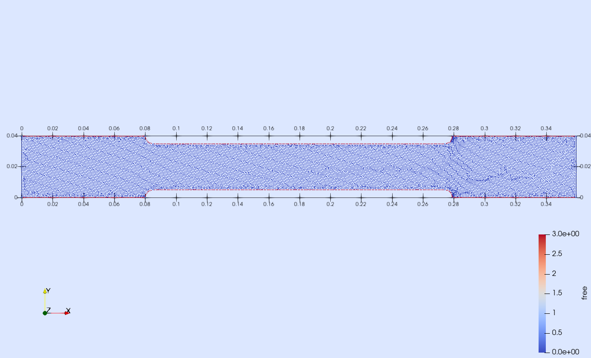
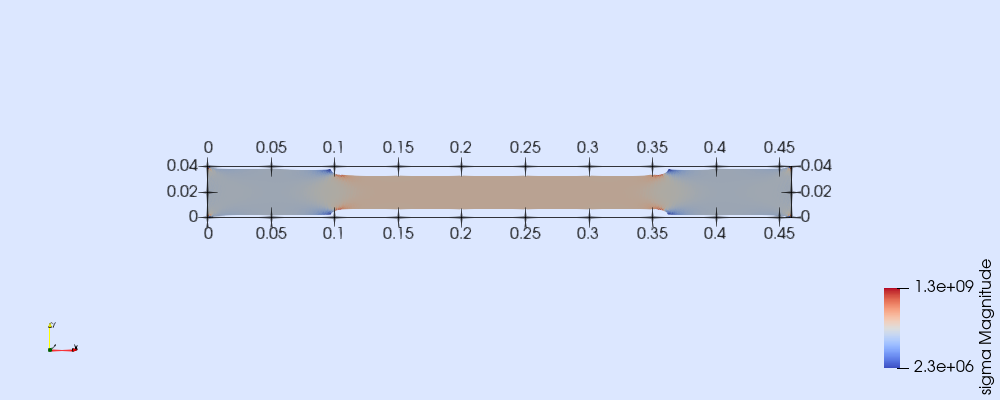
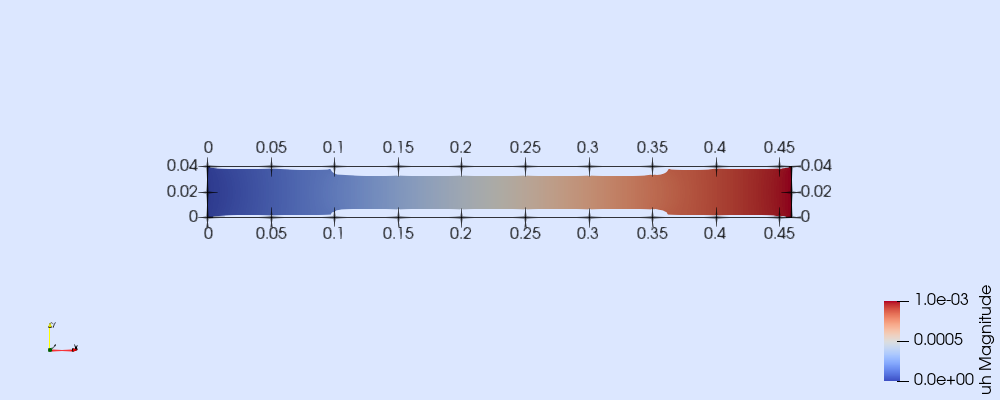

В одной из прошлых лекций был рассмотрен простейший случай нагружения плоского образца. Также были представлены матрицы упругости, деформаций, и как следствие, жесткости для плоской задачи с использованием треугольных элементов первого порядка. В данном уроке вопрос будет рассмотрен более подробно, а расчет будет осуществляться при помощи библиотеки с открытым исходным кодом Gridap, реализованной на языке Julia.

Как уже было сказано, в пределах малых деформаций зависимость между как напряжением и деформацией материала может считаться линейной и определяется законом Гука. Многим, из курса общей физики или сопротивления материалов, обобщенный закон Гука известен в следующей форме:

$$
\begin{cases}
   \varepsilon_x=\frac{1}{E}[\mathbf{\sigma} x-\nu (\mathbf{\sigma} y+\mathbf{\sigma} z)]; \\
   \varepsilon_y=\frac{1}{E}[\mathbf{\sigma} y-\nu (\mathbf{\sigma} x+\mathbf{\sigma} z)]; \\
   \varepsilon_z=\frac{1}{E}[\mathbf{\sigma} z-\nu (\mathbf{\sigma} x+\mathbf{\sigma} y)]; \\
   \gamma {xy}=\frac{\tau {xy}}{G}; \\
   \gamma {yz}=\frac{\tau {yz}}{G}; \\
   \gamma {zx}=\frac{\tau {zx}}{G};
   \end{cases}
$$

где $\varepsilon$ - линейная деформация вдоль оси, [б.р.]; $\mathbf{\sigma}$ - нормальное напряжение, [$\frac{Н}{м^2}$ = Па]; $E$ - модуль Юнга, [Па];  $\nu$ - коэффициент Пуассона, [б.р.]; $\tau$ - касательное напряжение, [$\frac{Н}{м^2}$ = Па]; $\gamma {xy}$ - угловая деформация, [б.р.]; $G$ - модуль сдвига, $G=\frac{E}{2(1+\nu)}$ [Па].

Коэффициент Пуассона показывает во сколько раз изменяется поперечное сечение деформированного тела при его растяжении или сжатии (величина отношения относительного поперечного сжатия к относительному продольному растяжению) и зависит от природы материала. Модуль Юнга (модуль упругости) - коэффициент, характеризующий сопротивление материала растяжению сжатию при упругой деформации. Два этих коэффициента полностью характеризуют упругие свойства изотропного материала.

Поскольку в общем случае напряжения и деформации являются тензорами, в следующем уроке будет представлена формулировка закона Гука с использованием тензорной алгебры. В данной лекции будет рассмотрено построение матрицы жесткости в общем виде с использованием метода Галеркина.

Хоть деформации и напряжения являются тензорами, в большинстве случаем требуется их представление в матричной форме. Так как данные тензора являются симметричными их можно представить в матричном виде с помощью нотация Фойгта.

$$
\varepsilon {12} = \varepsilon {21}; \hspace{0.7cm} \sigma_{12} = \sigma_{21}; \\
\varepsilon_{23} = \varepsilon_{32}; \hspace{0.7cm} \sigma_{23} = \sigma_{32}; \\
\varepsilon_{13} = \varepsilon_{31}; \hspace{0.7cm} \sigma_{13} = \sigma_{31}; \\
$$

Эта форма позволяет записать напряжения и деформации в виде векторов содержащих 6 компонент:

$$
    \mathbf{\sigma_v} =
    \left\{
        \begin{matrix}
            \sigma_{11}\\
            \sigma_{22}\\
            \sigma_{33}\\
            \sigma_{23}\\
            \sigma_{13}\\
            \sigma_{12}\\
        \end{matrix}
    \right\} = 
    \left\{
        \begin{matrix}
            \sigma_{x}\\
            \sigma_{y}\\
            \sigma_{z}\\
            \tau_{yz}\\
            \tau_{xz}\\
            \tau_{xy}\\
        \end{matrix}
    \right\} 
    \hspace{0.7cm}
    \ &
    \hspace{0.7cm}
    \mathbf{\varepsilon_v} = 
    \left\{
        \begin{matrix}
            \varepsilon_{11}\\
            \varepsilon_{22}\\
            \varepsilon_{33}\\
            2\varepsilon_{23}\\
            2\varepsilon_{13}\\
            2\varepsilon_{12}\\
        \end{matrix}
    \right\} = 
    \left\{
        \begin{matrix}
            \varepsilon_{x}\\
            \varepsilon_{y}\\
            \varepsilon_{z}\\
            \gamma_{yz}\\
            \gamma_{xz}\\
            \gamma_{xy}\\
        \end{matrix}
    \right\}
$$

Для простоты повествования, индекс $v$ в данной лекции будет опущен.

Тогда из общего закона Гука тензор упругости будет иметь вид:

$$
    \mathbf{E} = \frac{E(1-\nu)}{(1+\nu)(1-2\nu)}\left[
        \begin{matrix}
        1  & \frac{\nu}{1-\nu}  & \frac{\nu}{1-\nu}  & 0  & 0  & 0 \\
        \frac{\nu}{1-\nu}  & 1  & \frac{\nu}{1-\nu}  & 0  & 0  & 0 \\
        \frac{\nu}{1-\nu}  & \frac{\nu}{1-\nu}  & 1  & 0  & 0  & 0 \\
        0  & 0  & 0  & \frac{1-2\nu}{2(1-\nu)}  & 0  & 0 \\
        0  & 0  & 0  & 0  & \frac{1-2\nu}{2(1-\nu)}  & 0 \\
        0  & 0  & 0  & 0  & 0  & \frac{1-2\nu}{2(1-\nu)} \\

        \end{matrix}
    \right]
$$

Сам закон Гука можно переписать в матричном виде:

$$
 \mathbf{\sigma} = \mathbf{E}\mathbf{\varepsilon}
$$

## Плоское напряженное и плоское деформированное состояния

Приведённую выше зависимость можно упростить, если рассматриваемая область является плоской, а приложенные нагрузки или смещения действуют только в плоскости контура. В этом случае интегрирование вдоль третьего направления (обычно - вдоль Z) выполняется путем простого умножения на толщину.

Однако возможны два варианта. Плоско напряженное состояние - напряжения вдоль третьей оси полагаются нулевыми, а деформации свободны (отсутствуют ограничения вдоль третьей оси). Плоское деформированное состояния - деформации (а соответственно - и перемещения) фиксируются вдоль третьей оси, а напряжения остаются свободными.

Соответственно, для плоского деформированного состояния матрица упругости может быть получена из общего случая, путем вычеркивания лишних строк и столбцов:

$$
    \mathbf{E} = \frac{E(1-\nu)}{(1+\nu)(1-2\nu)}\left[
        \begin{matrix}
        1  & \frac{\nu}{1-\nu}  & 0 \\
        \frac{\nu}{1-\nu}  & 1  & 0 \\
        0  & 0  &  \frac{1-2\nu}{2(1-\nu)}  \\


        \end{matrix}
    \right]
$$

Для плоского напряженного состояния также необходимо учесть, что напряжения равны нулю. Тогда матрица примет вид:

$$
    \mathbf{E} = \frac{E}{1-\nu^2}\left[
        \begin{matrix}
        1  & \nu  & 0 \\
        \nu  & 1  & 0 \\
        0  & 0  &  \frac{1-\nu}{2}  \\


        \end{matrix}
    \right]
$$

```{julia}
#| lineno-start: 1

using Gridap
using Gridap.Arrays
using Gridap.Fields
using LinearAlgebra

tcf(filename::String) = (@__DIR__) * "\\" * filename;

const E = 2.1e11
const ν = 0.3

const λ = E*ν/(1+ν)/(1-2 ν)
const μ = E/2/(1+ν)


# Model
flag = 1;
k1 = ν/(1-ν);
k2 = 0.5*(1-2ν)/(1-ν);
k3 = (1-ν)/2;

plain_stress = true;
mE = Matrix{Float64}(undef, 3, 3);
if plain_stress
    mE[:,:] = [
        1  k1  0;
        k1  1  0;
        0   0 k2
    ] E (1-ν)/((1+ν) (1-2ν));   
else
    mE[:,:] = [
        1  ν  0;
        ν  1  0;
        0  0 k3;
    ] E/(1-ν^2);
end
```

```{julia}
#| lineno-start: 1

function voigtstrain(∇u)
    ε_x = ∇u[1,1];
    ε_y = ∇u[2,2];
    γ_xy = ∇u[1,2] + ∇u[2,1];

    return VectorValue(ε_x, ε_y, γ_xy);
end

function voigtstress(ε)
    σ_x = mE[1,1] * ε[1] + mE[1,2] * ε[2] + mE[1,3] * ε[3];
    σ_y = mE[2,1] * ε[1] + mE[2,2] * ε[2] + mE[2,3] * ε[3];
    τ_xy = mE[3,1] * ε[1] + mE[3,2] * ε[2] + mE[3,3] * ε[3];
    return VectorValue(σ_x, σ_y, τ_xy);
end
```

## Ленивые вычисления

```{julia}
#| lineno-start: 1

ϵ(u) = Operation(voigtstrain)(∇(u));
σ(u) = Operation(voigtstress)(ϵ(u));

# σ1(u) = voigtstress(ϵ(u))
σ = voigtstress ∘ ϵ

# σ(u) и u(x)
# σ_x = σ ∘ u
```

## Создание геометрии

В данном случае проведем моделирование плоского образца из стали. На левой границе перемещение равно нулю, правая граница перемещается на 1 мм.

```{julia}
#| lineno-start: 1

# ГОСТ 1497-84, образец плоский, тип I, образец номер №6
mm = 1e-3;
B = 40mm;
l0 = 140mm;
a0 = 20mm;
b0 = 30mm;
l = l0+2*sqrt(a0*b0);
h1 = 80mm;
r = (B-b0)/2;
```

```{julia}
#| lineno-start: 1

using Gmsh
using GridapGmsh

gmsh.initialize()

gmsh.option.setNumber("General.Terminal", 0);
ms_max = 1;
ms_min = 0.1;
MSFC = 3;
EL_ORDER = 1
gmsh.option.setNumber("Mesh.MeshSizeFromCurvature", MSFC);
# gmsh.option.setNumber("Mesh.MeshSizeMax", diam/2);
# gmsh.option.setNumber("Mesh.MeshSizeMin", diam/5);
gmsh.option.setNumber("Mesh.MaxNumThreads3D", 8);
gmsh.option.setNumber("Mesh.ElementOrder", EL_ORDER);
# gmsh.option.setNumber("Mesh.Algorithm3D", 9);
# gmsh.option.setNumber("Mesh.SubdivisionAlgorithm", 2);

gmsh.model.add("L_2_1")

Lc1 = 1mm;

factory = gmsh.model.geo;
factory.addPoint(0,             0,      0, Lc1, 1); #left-bottom corner
factory.addPoint(h1,            0,      0, Lc1, 2); #begin of first arc
factory.addPoint(h1+r,          0,      0, Lc1, 3); #center of first arc
factory.addPoint(h1+r,          r,      0, Lc1, 4); #end of first arc
factory.addPoint(h1+r+l,        r,      0, Lc1, 5); #begin of second arc
factory.addPoint(h1+r+l,        0,      0, Lc1, 6); #center of second arc
factory.addPoint(h1+r+l+r,      0,      0, Lc1, 7); #begin of second arc
factory.addPoint(h1+r+l+r+h1,   0,      0, Lc1, 8); #right-buttom corner
factory.addPoint(h1+r+l+r+h1,   B,      0, Lc1, 9); #right-top corner
factory.addPoint(h1+r+l+r,      B,      0, Lc1, 10); #begin of third arc
factory.addPoint(h1+r+l,        B,      0, Lc1, 11); #center of third arc
factory.addPoint(h1+r+l,        B-r,    0, Lc1, 12); #end of third arc
factory.addPoint(h1+r,          B-r,    0, Lc1, 13); #begin of fourth arc
factory.addPoint(h1+r,          B,      0, Lc1, 14); #center of fourth arc
factory.addPoint(h1,            B,      0, Lc1, 15); #end of fourth arc
factory.addPoint(0,             B,      0, Lc1, 16); #end of fourth arc


factory.addLine(1, 2, 1);
factory.addCircleArc(2, 3, 4, 2);

factory.addLine(4, 5, 3);
factory.addCircleArc(5, 6, 7, 4);

factory.addLine(7, 8, 5);
factory.addLine(8, 9, 6);
factory.addLine(9, 10, 7);
factory.addCircleArc(10, 11, 12, 8);

factory.addLine(12, 13, 9);
factory.addCircleArc(13, 14, 15, 10);
factory.addLine(15, 16, 11);
factory.addLine(16, 1, 12);

factory.addPhysicalGroup(1, [12], -1, "left");
factory.addPhysicalGroup(1, [6], -1, "right");
factory.addPhysicalGroup(1, [1, 2, 3, 4, 5, 7, 8, 9, 10, 11], -1, "free");

factory.synchronize();

factory.addCurveLoop(collect(1:12), 13);


factory.addPlaneSurface([13], 6)


factory.synchronize()

factory.addPhysicalGroup(2, [6], -1, "test_sample");

factory.synchronize()

gmsh.model.mesh.generate(2)


name = "test_sample.msh" |> tcf;
print(name)
gmsh.write(name)

# gmsh.fltk.run()

gmsh.finalize()
```

```{julia}
#| lineno-start: 1

model = GmshDiscreteModel(name);

vtk_file = "model_speciment" |> tcf;
writevtk(model, vtk_file); # запишем модель в vtk
```

В результате был создан файл с облаком точек. Можно легко проверить границы которые имеются в импортированном файле в программе Paraview.



## Векторнозначное пространство КЭ

В примере на первой лекции мы искали поле температуры, которое является полем констант, в данном же случае мы ищем поле перемещений, которое является векторным полем. Здесь нам нужно построить векторнозначное пространство КЭ, что делается следующим образом:

```{julia}
#| lineno-start: 1

model = GmshDiscreteModel(name);

reffe = ReferenceFE(lagrangian,VectorValue{2,Float64},1) #Как и в предыдущем уроке, мы строим непрерывную интерполяцию Лагранжа первого порядка...
#...Векторно-значная интерполяция выбирается с помощью "VectorValue".

V = TestFESpace(model,reffe,conformity=:H1,dirichlet_tags = ["left", "right"])

g0 = VectorValue(0.0,  0.0) # Граничное условие на левой грани – перемещение 0.
g1 = VectorValue(1.0mm, 0.0) #Граничное условие на правой грани – перемещение 1 мм.

U = TrialFESpace(V, [g0,g1]) # Создаем пространство тестовых функций.
```

## Слабая форма

Как и в прошлом примере, для того, чтобы определить слабую форму, нам нужно построить сетку интегрирования и соответствующую меру

```{julia}
#| lineno-start: 1

degree = 2
Ω = Triangulation(model)
dΩ = Measure(Ω,degree)
```

Так как тело $\Omega$ находится в равновесии, то для него может быть записано уравнение равновесия (уравнение Навье-Стокса):

$$
-\nabla  \cdot \mathbf{\sigma}(u) = f \hspace{0.25cm} in \hspace{0.1cm}\Omega
$$

где $\mathbf{\sigma}(u)$ - тензор напряжений, $f$ - объёмная сила.

Как и в предыдущей лекции можем до множить обе части уравнения на пробную (или тестовую) функцию $v$ и взять интеграл по Ω с обеих сторон уравнения. При этом функция $u$, которая разрешает интегральное уравнение для достаточного числа различных функций $v$, является решением исходного ДУЧП.

$$
-\int_{\Omega}^{}(\nabla \cdot \mathbf{\sigma}(u))\cdot vdx =\int_{\Omega}^{}f\cdot vdx
$$

Поскольку $\nabla \cdot \mathbf{\sigma}(u)$ содержит производные второго порядка от нашего неизвестного $u$, проинтегрируем этот член по частям:

$$
-\int_{\Omega}^{}(\nabla\cdot \mathbf{\sigma}(u))\cdot vdx = \int_{\Omega}^{}\mathbf{\sigma}(u)\cdot \nabla vdx - \int_{d\Omega}^{}(\mathbf{\sigma}(u)\cdot n)\cdot vdx
$$

где $n$ -  внешняя нормаль на границе. Величина $\mathbf{\sigma}(u)\cdot n$ называется вектором тяги или напряжения на границе и часто задается в качестве граничного условия.

Таким образом билинейное уравнение будет выглядеть следующим образом:

$$
a(u,v)=\int_{\Omega}^{}\mathbf{\sigma}(u) \cdot \nabla vdx
$$

Можно показать, что внутреннее произведение симметричного тензора $\mathbf{A}$ и антисимметричный тензор $\mathbf{B}$ равно нулю. Если мы выразим $\nabla v$ в виде суммы его симметричной и антисимметричной частей, в произведении сохранится только симметричная часть $\mathbf{\sigma}(u) \cdot \nabla v$ поскольку $\mathbf{\sigma}$ – это симметричный тензор. Таким образом, замена $\nabla v$ симметричным градиентом $\mathbf{\epsilon}(v)$ приводит к несколько иной форме билинейного уравнения:

$$
a(u,v)=\int_{\Omega}^{}\mathbf{\sigma}(u) \cdot \mathbf{\epsilon}(v)dx
$$

где $\mathbf{\epsilon}(v)$  симметричная часть $ \nabla v$:

$$
\mathbf{\epsilon}(v)=1/2(\nabla v+ (\nabla v)^T)
$$

Линейное уравнение:

$$
L(v)=\int_{\Omega}^{}f\cdot vdx+\int_{d\Omega}^{}(\mathbf{\sigma}(u)\cdot n)\cdot vdx
$$

Таким образом можем записать слабую форму:

```{julia}
#| lineno-start: 1

A(u,v) = ∫( ϵ(v)⋅σ(u))*dΩ
L(v) = 0; #∫(dot(f, v))*dΩ
```

## Решение задачи КЭ

Остальные шаги решения задачи КЭ по сути те же, что и в предыдущем уроке.

```{julia}
#| lineno-start: 1

op = AffineFEOperator(A, L, U,V)

x0 = zeros(Float64, num_free_dofs(V))
uh_lin = FEFunction(U,x0)
ls = BackslashSolver()
solver = LinearFESolver(ls)

uh_lin, _ = solve!(uh_lin,solver,op)
```

Наконец, мы записываем результаты в файл. Обратите внимание, что мы также включаем тензоры деформации и напряжений в файл результатов.

```{julia}
#| lineno-start: 1

res_file = "results_new" |> tcf;

writevtk(Ω, res_file, cellfields=["uh" => uh_lin, "sigma" => σ(uh_lin)])
```

В результате было получено поле напряжений и поле перемещений, которые представлены на рисунках ниже. Визуализация результатов проводилась так же с использованием Paraview, для наглядности Scale Factor = 100.



Поле напряжений



Поле перемещений