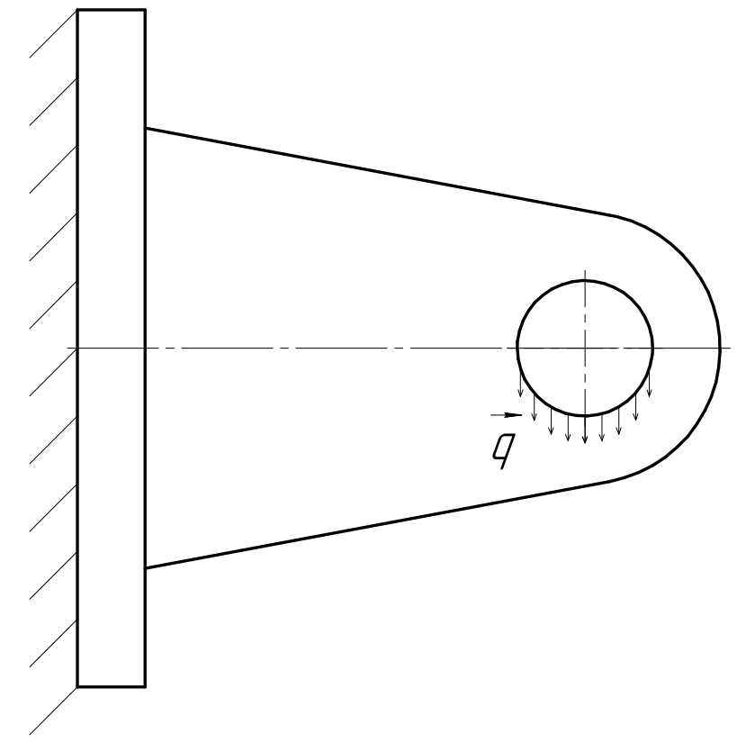
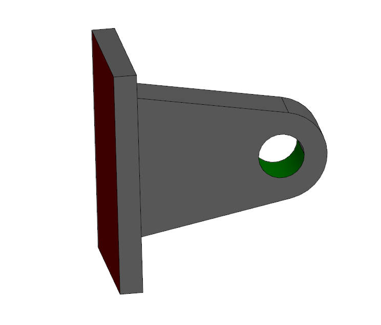

```{julia}
#| output: false
#| echo: false
tcf(filename::String) = (@__DIR__) * "\\" * filename;
```

# Введение
В рамках данного урока м рассмотрим трехмерную задачу о нагружении кронштейна.
В прошлых уроках мы строили геометрию вручную при помощи инструментов gmsh, однако для более сложной геометрии такой подход не слишком удобен, и гораздо проще воспользоваться какой-либо CAD системой, позволяющей строить 3D геометрию.
Расчетная схема представлена на следующем рисунке.




В данном случае, геометрия была построена в [бесплатном пакете FreeCAD]/[отечественном пакете Компас3D] и экспортирована в формат `*.stp`. Полученная геометрия показана на рисунке ниже.



Для приложения нагрузки цилиндрическая поверхность была разделена на две половины и нижняя окрашена в цвет RGB(0, 100, 0). В дальнейшем мы буем использовать цвет поверхности для быстрого поиска данной поверхности при загрузке ее gmsh. Аналогичным образом поверхность, которая фиксируется, помечена цветом RGB(100, 0, 0).

## Импорт геометрии подготовка КЭ сетки

Импорт готовой геометрии в gmsh осуществляется при помощи функции `gmsh.model.occ.importShapes(file_name)`
Далее необходимо выявить индексы поверхностей, которые были помечены при моделировании. Для этого можно поместить их в словарь, ключем которого будет цвет, а значением - индекс поверхности. После этого данным поверхностям следует задать метки, для чего необходимо поместить их в физический группы при помощи команды `gmsh.model.addPhysicalGroup(dim, ents, id, label)`, где:
- `dim::Integer` - размерность физической группы (0 - точки, 1 - ребра, 2 - поверхности, 3 - объемы);
- `ents::Vector{<:Integer}` - вектор из индексов объектов, которые планируется добавить к физической группе;
- `id::Integer` - индекс создаваемой группы (в случае, если будет передано `-1` - индекс проставится автоматически);
- `label::String` - метка создаваемой группы
Кроме того, необходимо создать физическую группу для основного тела, для того чтобы в дальнейшем gmsh включил его в задание на построение сетки.


```{julia}
#| output: false
using Gmsh

gmsh.initialize()
gmsh.option.setNumber("General.Terminal", 0)
gmsh.option.setNumber("Mesh.MeshSizeMax", 5)
gmsh.model.add("model")


path = "lug.stp" |> tcf
v = gmsh.model.occ.importShapes(path)


gmsh.model.occ.synchronize()

faces = Dict()
for plane in gmsh.model.getEntities(2)
    faces[gmsh.model.getColor(plane...)] = plane[2];
    # gmsh.model.addPhysicalGroup(2, [plane[2]], -1, "$(plane[2])");
end


d3 = gmsh.model.getEntities(3)
gmsh.model.addPhysicalGroup(3, [d3[1][2]], -1, "domain")

d2 = gmsh.model.getEntities(2)
gmsh.model.addPhysicalGroup(2, [faces[(0,100,0,255)]], -1, "loaded")
gmsh.model.addPhysicalGroup(2, [faces[(100,0,0,255)]], -1, "fixed")

gmsh.model.occ.synchronize()
```

Далее необходимо задать параметры для построения сетки. В Gmsh предусмотрено несколько вариантов задания параметров сетки. Один из них - при помощи команды gmsh.options.setNumber("Parameter"). В качестве параметров можно задать:
 - минимальный и максимальный размеры элемента
 - количество элементов на криволинейных поверхностях
 - алгоритм триангуляции
 - и т.д.
Подробный список параметров можно посмотреть в руководстве gmsh.

После этого необходимо синхронизировать модель, выполнить генерацию сетки, сохранить результат в файл и завершить сессию gmsh.


```{julia}
#| output: false

gmsh.option.setNumber("Mesh.MeshSizeMax", 3.0)          #Максимальный размер элементов внутри всей модели - 3мм
gmsh.option.setNumber("Mesh.MeshSizeFromCurvature", 50) #колличество элементов на 2pi радиан

gmsh.model.mesh.generate(3)
msh_file = "lug.msh" |> tcf;
gmsh.write(msh_file)

# gmsh.fltk.run()

gmsh.finalize();
```

## Создание модели в Gridap

В этот раз, в отличие от предыдущего урока, воспользуемся встроенным в Gridap функционалом для построения конечных элементов.

Мы уже упоминали, что напряжения и деформации являются тензорами [1]. 

$$
\mathbf{\varepsilon} = 
\begin{bmatrix}
\varepsilon_{11} & \varepsilon_{11} & \varepsilon_{13}\\
\varepsilon_{21} & \varepsilon_{22} & \varepsilon_{23}\\
\varepsilon_{31} & \varepsilon_{32} & \varepsilon_{33}\\
\end{bmatrix}
\quad
\mathbf{\sigma} =
\begin{bmatrix}
\sigma_{11} & \sigma_{11} & \sigma_{13}\\
\sigma_{21} & \sigma_{22} & \sigma_{23}\\
\sigma_{31} & \sigma_{32} & \sigma_{33}\\
\end{bmatrix}
$$ 

В тензорном виде закон Гука может быть записан следующим образом:

$$
\rm{\sigma}(u) = \lambda \mathrm{tr}\left(\bm{\varepsilon}(u)\right)\mathbf{I} +2\mu\mathbf{\varepsilon}(u) 
$$ 

```{julia}
#| output: false

const E = 2.1e5
const ν = 0.3
const λ = (E*ν)/((1+ν)*(1-2*ν))
const μ = E/(2*(1+ν))

σ(ε) = λ*tr(ε)*one(ε) + 2*μ*ε

using Gridap
using GridapGmsh

# model = GmshDiscreteModel(msh_file);

# vtk_file = "model" |> tcf;
# writevtk(model, vtk_file);


##


model = GmshDiscreteModel(msh_file);

reffe = ReferenceFE(lagrangian,VectorValue{3,Float64},1) #Как и в предыдущем уроке, мы строим непрерывную интерполяцию Лагранжа первого порядка...
#...Векторно-значная интерполяция выбирается с помощью "VectorValue".

V = TestFESpace(model,reffe,conformity=:H1,dirichlet_tags = ["fixed"])

g(x) = VectorValue(0.0,  0.0, 0.0) # Граничное условие на левой грани – перемещение 0.

U = TrialFESpace(V, [g]) # Создаем пространство триальных функций.
EL_ORDER = 1
degree = EL_ORDER*2
Ω = Triangulation(model)
dΩ = Measure(Ω,degree)

neumanntags = ["loaded"]
Γ = BoundaryTriangulation(model,tags=neumanntags)
dΓ = Measure(Γ,degree)

α = deg2rad(30)

f(x) = VectorValue(0.0, 0.0, 0.10);

a(u,v) = ∫(ε(v) ⊙ (σ∘ε(u)) )*dΩ
b(v) = ∫( dot(v, f))*dΓ 


op = AffineFEOperator(a,b,U,V)
x0 = zeros(Float64, num_free_dofs(V))
uh_lin = FEFunction(U,x0)

ls = BackslashSolver()
solver = LinearFESolver(ls)

uh_lin, _ = solve!(uh_lin,solver,op)

res_file = "results_new" |> tcf;

function mises(s)
    return 0.5 * sqrt((s[1,1] - s[2,2])^2 + (s[2,2] - s[3,3])^2 + (s[3,3] - s[1,1])^2 + 6 * (s[2,3]^2 + s[3,1]^2 + s[1,2]^2))
end

writevtk(Ω, res_file ,  cellfields=["uh"=>uh_lin,"sigma"=>σ∘ε(uh_lin)])
```

