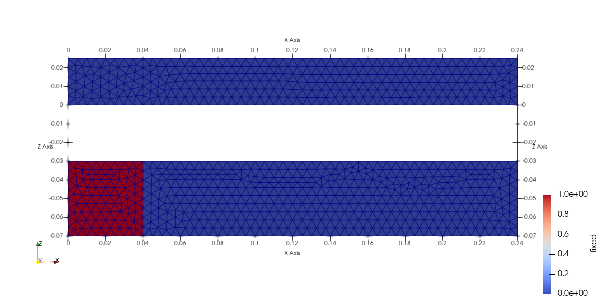
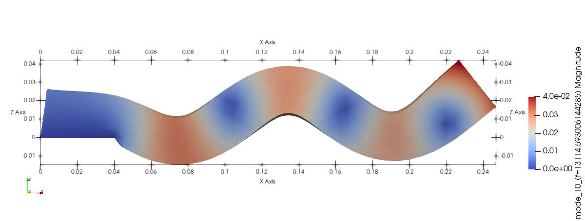

```{julia}
#| output: false
#| echo: false
tcf(filename::String) = (@__DIR__) * "\\" * filename;
```

## Исходные данные

Проведем анализ частот и форм собственных колебаний балки прямоугольного сечения $40мм\times 25мм \times 240мм$ из алюминия ($E=70ГПа$, $\mu=0{,}33$, $\rho=2800\frac{кг}{м^3}$). Закрепление осуществляется по части нижней грани - площадка длиной $40мм$, имитируя абсолютно жесткое клеевое соединение. Поверхность закрепления показана на рисунке.



```{julia}
using Gridap
using GridapGmsh

# msh_file = "geometry.msh" |> tcf;

# model = GmshDiscreteModel(msh_file);

const E = 70.0e9
const ν = 0.33
const λ = (E*ν)/((1+ν)*(1-2*ν))
const μ = E/(2*(1+ν))
const ρ = 2.8e3
σ(ε) = λ*tr(ε)*one(ε) + 2*μ*ε

mm = 1e-3;
l_full = 240mm;
l_fixed = 40mm;
w = 40mm;
h = 25mm;


vtk_file = "geometry" |> tcf;

domain = (0,l_full,-w/2,w/2, 0,h)
partition = (100,20, 10)
model = CartesianDiscreteModel(domain, partition)
writevtk(model, vtk_file);


degree = 2
Ω = Triangulation(model)
dΩ = Measure(Ω,degree)


reffe = ReferenceFE(lagrangian,VectorValue{3,Float64},1)
V = TestFESpace(model,reffe,conformity=:H1);#,dirichlet_tags = ["fixed"])

g0 = VectorValue(0.0,  0.0, 0.0)
# g1 = VectorValue(0.0, 0.0)

U = TrialFESpace(V)#, [g0])


```


## Уравнение динамики

Ранее были рассмотрены задачи статики, которые сводились к решению уравнению вида
$$
\mathbf{Ku}=\mathbf{f}
$$
В данном уравнении учитывается только восстанавливающая сила $\mathbf{F}_r(\mathbf{u}) = \mathbf{Ku}$

В случае, если задача нестационарная, необходимо также учитывать инерционные и
$$
    \mathbf{F}_i(\mathbf{u}, \dot{\mathbf{u}}, \ddot{\mathbf{u}}) = \mathbf{M}\ddot{\mathbf{u}}
$$
и диссипативные силы
$$
    \mathbf{F}_d(\mathbf{u}, \dot{\mathbf{u}}, \ddot{\mathbf{u}}) = \mathbf{C}\dot{\mathbf{u}}
$$

Тогда полное уравнение динамики примет вид:
$$
    \mathbf{M}\ddot{\mathbf{u}} + \mathbf{C}\dot{\mathbf{u}} + \mathbf{Ku}=\mathbf{f}_{o}(t)
$$
Данная система является системой диффференциальных уравнений второго порядка.

При анализе собственных частот исследуют так называемые "свободные"  колебания - колебания без воздействия внешней силы $\left(\mathbf{f}_{o}(t) = 0 \right)$, возникающие при некоторых начальных условиях $\left(\mathbf{u}(0) = \mathbf{u}_0; \: \dot{\mathbf{u}}(0) = \mathbf{v}_0; \right)$. Частоты, на которых система колеблется при отсутствии внушних сил, наываются **собственными частотам** (СЧ). Кроме того, из экспериментальных работ известно, что контрукционное демпфирование обычно довольно мало, и оказывает незначительное влияние на СЧ. Поэтому исследование собственных колебаний начинаю с исследования консервативной системы, т.е. без наличия диссипативных сил:
$$
    \mathbf{M}\ddot{\mathbf{u}} + \mathbf{Ku}= 0
$$. 
Решение такого уравнения будем искать в виде
$$
    \mathbf{u} = \mathbf{u}_0 \sin(\omega t + \phi_0)
$$

Если подставить даннове решение в предыдущее, то получится следующая система:
$$
    -\omega^2\mathbf{M}\mathbf{u}_0 \sin(\omega t + \phi_0) + \mathbf{K} \mathbf{u}_0 \sin(\omega t + \phi_0)= 0
$$
Если отбросить тривиальные решения $\left( \mathbf{u}_0 = 0\right)$, то для решения системы необходимо обращения в нуль определителья матрицы
$$
\det\left( \mathbf{K} -\omega^2\mathbf{M}\right) = 0
$$

Если ввести замену $\lambda = \frac{1}{\omega^2}$ и поделить на матрицу жесткости, то задача сведется к отысканию таких $\omega$ и $\mathbf{u}_0$, при которых выполняется следующее условие:

$$
    \mathbf{K}^{-1} \mathbf{M} \mathbf{u}_0 = \lambda \mathbf{u}_0
$$
Данная задача носит название **проблемы собственных значений** и как извествено имеет N решений, где N - размерность матриц жесткости и масс. Иначе говоря, у системы имеется N СЧ и N векторов $\mathbf{u}_0$, которые задают форму согласно с которой осущестляетс деформация при колебаниях на данной СЧ. Эти вектора называются **собственными формами** или просто **формами** колебаний.

Для решения используется собственное разложение, позволяюще представить матрицу в виде произведениея
$$
\mathbf{K}^{-1}\mathbf{M} = \mathbf{V}\mathbf{\Lambda}\mathbf{V}^T
$$
где $\mathbf{V}$ - матрица собственных векторов, столбцами которой являются собственные формы
$$
    \mathbf{V} = \left[ 
        \begin{matrix}
            | & | & | &&|\\
            \mathbf{u}_0^1 & \mathbf{u}_0^2 & \mathbf{u}_0^3 & \dots & \mathbf{u}_0^N\\ 
            | & | & | &&|\\
        \end{matrix}
    \right]
$$
a $\mathbf{\Lambda}$ - матрица собственных значений
$$
     \mathbf{\Lambda} = \left[ 
        \begin{matrix}
            \lambda_1 & 0 & 0 & \dots & 0\\
            0 & \lambda_2 & 0 & \dots & 0\\
            0 & 0 & \lambda_3 & \dots & 0\\
            \vdots & \vdots & \vdots & \ddots & \vdots\\ 
            0 & 0 & 0 & \dots & \lambda_N\\
        \end{matrix}
    \right]
$$

## Составление ансамбля
Отличием исследования на собственные частоты, от статического анализа, является то, что необходимо составить две билененых формы и соответствующих им оператора - для матрицы жесткости и для матрицы масс.

Сборка матрицы жесткости не отсличается от того, как она  осуществлялась ранее.
Слабая форма для матрицы масс выводится из условия минимизации потенциальной энергии выглядит следующим образом:
$$
    \rho\int_{\Omega}^{}{ \mathbf{u} \cdot \mathbf{v} d\Omega}
$$
И хотя линейная форма в данном случае не  требуется, т.к. внешнии силы отсутствуют и решение системы как таковое не оосуществляется, она необхоимо для процедуры сборки, поэтому объявим ее как нулевую.

```{julia}
bfK(u,v) = ∫( ε(v) ⊙ (σ∘ε(u)) )*dΩ
bfM(u,v) = ρ*∫(v⋅u)dΩ
L(v) = 0; #∫(dot(f, v))*dΩ
op_K = AffineFEOperator(bfK, L, U, V);
mK = get_matrix(op_K);

op_M = AffineFEOperator(bfM, L, U, V);
mM = get_matrix(op_M);
```

После того как мы получили глобальные матрицы жесткости $\mathbf{K}$ и масс $\mathbf{M}$ можем определить выполнить собственное разложение матрицы $\mathbf{T} = \mathbf{K}^{-1}\mathbf{M} = \mathbf{V}\mathbf{\Lambda}\mathbf{V}^T$

> **_Примечание:_**
>
> В дествительности, операция собственного разложения для произведения матриц вида $\mathbf{B}^{-1}\mathbf{A}$ настолько распространенная операция, что для ее вычисления существет специальный алгоритм. Все дело в том, что матрицы, получаемые в результате сборки задачи МКЭ являются ***разреженными*** (см. [описание](https://ru.wikipedia.org/wiki/%D0%A0%D0%B0%D0%B7%D1%80%D0%B5%D0%B6%D0%B5%D0%BD%D0%BD%D0%B0%D1%8F_%D0%BC%D0%B0%D1%82%D1%80%D0%B8%D1%86%D0%B0)), для которых существуют отдельные высокоэффективные алгоритмы, и в том числе, для их спектрального разложения. Но при обращении  произвольной разреженной матрицы зачастую получается ***плотная*** матрица, алгоритмы работы с которыми гораздо менее эффективны.

Для нашего примера, расчитаем лишь первые 10 собственных частот и форм, для чего воспользуемся функцией `eigs` из библиотеки `Arpack` позволяющей эффективно вычислять собственное и сингулярное разложение для больших разряженных матриц.

```{julia}
using Arpack

num_eig_vectors = 20

res = eigs(mM, mK; nev = num_eig_vectors, which=:LM)
```

Согласно (1) угловая скорость может быть вчислена из собственного числа матрицы $\mathbf{T}$
$$
    \omega_i  = \frac{1}{\sqrt{\lambda_i}}\\
    
$$
откуда легко получить собственную частоту
$$
    
    f_i = \frac{\omega_i}{2\pi}

$$

```{julia}

freqs = [sqrt(1/λ) / (2π) for λ in abs.(real.(res[1]))]
```

После этого можно сохранить и визуализировать все полученные формы колебаний.
`Gridap` позволяет экспортировать несколько полей файл результатов. Для этого непобходимо создать словарь с полями, которые хотим экспортировать.

```{julia}
eigen_modes = Dict()
for (i,(f,vec)) in enumerate(zip(freqs,eachcol(res[2])))
    eigen_modes["mode_$(i)_(f=$f)"] = FEFunction(U,real.(vec))
end


res_file = "eigen_freq" |> tcf;

writevtk(Ω, res_file ,  cellfields=eigen_modes)
```

## Сравнение с аналитической моделью

Аналитически собственные частоты изгибных колебаний в плоскости $YZ$ консольно заделаной балки можно расчитать по следующей формуле:
$$
    f_i = k_i^2 \sqrt{\frac{E I_x}{m l^4}}
$$
где $k_i = \left[1{,}875; 4{,}694; 7{,}855 \right]$ -коэффициент формы, $m$ - погонная масса балки, $I_x$ - осевой момент инерции сечения балки, $l$ - длина балки.
Аналогично можно рассчитать и частоты колебаний в плоскости $ZX$, для этого достаточно заменить момент инерции $I_x$ на $I_y$

Отдельное внимание, следует уделить закреплению. Приведенная формула работает для закрепления когда заделка "идеальная". В нашем же случае закреплена лишь нижняя часть балки. С одной стороны, длина консоли (свободной части балки) составляет $l_{full} - l_{fixed} = 200мм$ и именно ее следовало подставить в формулу.

```{julia}
k = [1.875, 4.694, 7.855]
Ix = w * h^3 / 12
Iy = h * w^3 / 12
I = [Ix, Iy]
m = w*h*ρ
freq_analytical = Matrix{Float64}(undef, 3, 2)
for i in 1:3, j in 1:2
    freq_analytical[i,j] = k[i]^2 * sqrt(E*I[j] / (m * (l_full - l_fixed)^4)) / (2π)
end
freq_analytical
```

Однако из рассчета видно, что полученные значения существенно выше аналогичных, полученных при помощи МКЭ.
Действительно, если внимательно изучить 10-ю собственную форму, то видно, что часть балки, которая находится над зоной закрепления, так же подвергается деформированию, а следовательно вносит свой вклад в динамическую жествкость.
Следовательно, использовать в расчете формальную длину консоли при таком способе закрепления не совсем корректно, и более верно было бы говорить о некой "эффективной" длине консоли, которая несколько больше, чем формальная.




## Задания для самостоятельной проработки
1. Подберите эффективную длину консоли для данной задачи.
2. Надите формулу для крутильных колебаний  консольной балки и сравните результаты. Какая погрешность получилась для крутильных СЧ?
3. Найдите собственные частоты, соответствующие поперечным колебаниям балки (растяжение-сжатие). Объясните получившуюся форму.
4. По имеющемуся файлу `geometry.geo` составьте код на `Julia`, которыйй генерирует такю же геометрию. Добавьте симметричную верхнуюю грань в физическую группу `"fixed"`. Как это повлияло на решение?